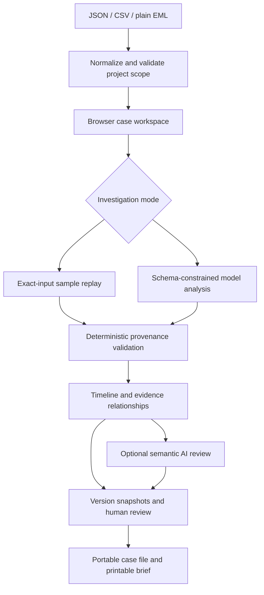

# CaseLens 2.3 architecture and contracts

## Request path

## Data boundaries

- Project scope is explicit in every source, not inferred from names.
- Sources are normalized before model calls; duplicate IDs and mixed projects
  are rejected. Repeated body text is flagged, not removed or treated as
  independent confirmation.
- Full source bodies are provided within a bounded context. No vector search,
  external lookup, embeddings or remote attachment fetching is implemented.
- All model-facing source content is untrusted data. The model has no tools
  that can email, execute code, fetch URLs or mutate customer systems.
- Every accepted report passes the schema and source-quote validator. Timeline
  dates are parsed with timezone and sorted as instants, not string order.
- The semantic reviewer receives a deterministic claim registry. Its output
  must assess each registry ID exactly once. Claims are stable within a report,
  not guaranteed to have the same ID across separate model generations.
- Version comparison shows source differences and summary/commitment snapshots.
  It does not pretend to solve fuzzy cross-version entity matching.

## API

| Endpoint | Input | Output / behavior |
| --- | --- | --- |
| `GET /health` | None | Liveness status |
| `GET /api/config` | None | Mode availability and model names, never credentials |
| `GET /api/cases` | None | Fictional sources and metadata; no preloaded report results |
| `POST /api/normalize` | Project JSON or format/content/project | Normalized sources and diagnostics; no AI call |
| `POST /api/investigate` | project, sources, mode | Validated report, evidence analysis and runtime metadata |
| `POST /api/ask` | project, sources, question | One evidence-linked answer; live call |
| `POST /api/review` | project, sources, report | Per-claim semantic assessments; live call |
| `POST /api/inspect` | project, sources, report | Provenance-rechecked import with unverified-origin label |

The schema is the source of truth in `app/schema.py`. `app/validation.py`
implements only the schema subset used by this application, not a general
JSON Schema implementation.

## Limits and lifecycle

| Boundary | Implemented limit |
| --- | --- |
| Sources | 1–60 per investigation |
| Source body | 12,000 characters each; 80,000 combined |
| Ordinary POST | 250,000 bytes |
| Review / inspect POST | 500,000 bytes including report |
| Portable case-file import | 8 MB in browser; each server request has its own limit |
| Versions | Last 10 per case in the current browser tab |
| Semantic review | At most 45 registered claims |
| Provider response | At most 2 MB, 90-second provider timeout |
| AI concurrency | 2 provider calls per process |
| POST rate | 15/minute per observed connection IP |
| Daily AI attempts | Configurable, default 50/process/UTC day; resets on restart |
| Live report cache | Last 20 entries in process memory, keyed by source/project fingerprint and model |

No user records are written to a server database. Downloading a case file is
an explicit local export containing source bodies and notes. Restoring checks
quote provenance again, ignores claimed origin metadata and discards old model
reviews. This protects against treating a hand-edited JSON as a verified live
model run; it does not authenticate the original sender or human reviewer.

## Failure behavior

- Invalid input is rejected before AI use.
- Provider authorization/quota/network errors are translated into useful
  messages without returning provider response bodies or keys.
- Refused/incomplete model output is not shown as a completed investigation.
- Invalid quotations cause a report or review to be rejected, not silently fixed.
- Semantic review failure does not overwrite the original report.
- Changing source scope invalidates the current visible report and preserves
  previous versions; the new scope requires another investigation.
- No silent fallback from Live AI to an authored report.

## Production work deliberately outstanding

The included HTTP server is for a bounded hackathon demo behind managed HTTPS.
Before production use: authenticated tenant isolation, durable version storage,
audited reviewer identities, secret management, distributed rate/budget limits,
worker/job infrastructure, observability, retention and connector permissions.
These are not implemented or claimed as ready.

## Conditional commitments and causal interpretation

Commitments contain delivery `status` (open, fulfilled, changed, not_verified,
overdue), `condition`, `condition_status` (not_stated, met, not_met, unknown),
`status_reason`, and evidence. Overdue requires sourced post-target noncompletion;
missing confirmation alone remains not_verified. These assessments are model
interpretations, not deterministic legal findings. Legacy restores get an
explicit unassessed condition and retain unverified-origin status.

Review receives the delivery, prerequisite, rationale and next-action premises.
Generation/review instructions prohibit causal conclusions from chronology alone;
source-stated causes must be attributed and hypotheses labeled. Neither the
schema nor the quote validator can guarantee causal correctness.

## Provider and credential isolation

AI_PROVIDER selects Gemini generateContent structured JSON or OpenAI Responses.
Optional X-AI-Key/Provider/Model headers set a ContextVar for only the current
request, reset in a finally block. No environment mutation is used. Visitor
requests bypass report caching. No user-specified provider URL is accepted.
ALLOW_SERVER_AI=false disables server fallback; visitor keys still work.
Key controls use tab memory, no browser storage, and never enter case data.
The trusted app server receives these credentials; HTTPS and host trust matter.
Shared process quotas remain, not per-account production isolation.
